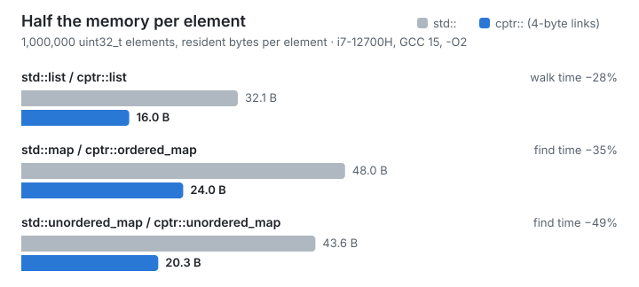

#  compressed-ptr

[](https://github.com/mvanslobbe/compressed-ptr/actions/workflows/ci.yml)
[](https://mvanslobbe.github.io/compressed-ptr/coverage/)
[](https://mvanslobbe.github.io/compressed-ptr/)


[](LICENSE)
[](https://godbolt.org/z/cTz9KfczY)

**Half the memory for pointer-heavy C++.** Header-only C++20 library of
4-byte pointers and drop-in containers, built on the same trick as
[V8's pointer compression](https://v8.dev/blog/pointer-compression).
**[Try it in your browser](https://godbolt.org/z/cTz9KfczY)**, or read
[why half your pointers are wasted](https://mvanslobbe.github.io/compressed-ptr/why.html).

<p align="center"></p>

| 1,000,000 `uint32_t` elements | `std::` | `cptr::` | memory | speed |
|---|---:|---:|---:|---:|
| `list`, walk | 32.1 B · 1.9 ns | **16.0 B · 1.3 ns** | **−50%** | **−28%** |
| `map` / `ordered_map`, find | 48.0 B · 404 ns | **24.0 B · 268 ns** | **−50%** | **−35%** |
| `unordered_map`, find | 43.6 B · 16.5 ns | **20.3 B · 8.4 ns** | **−53%** | **−49%** |

Bytes per element (resident memory) and time per operation; i7-12700H,
GCC 15, `-O2`. **Get your own numbers in one command:**
`./build/example_expect_gains`. **Full results:
[benchmark pages](https://mvanslobbe.github.io/compressed-ptr/benchmarks.html),
including [compressed against raw pointers at p50 to p99.5](https://mvanslobbe.github.io/compressed-ptr/benchmarks.html#compressed-against-raw-pointers).**

## Start in two minutes

Header-only; C++20 and a 64-bit target (Linux, macOS, Windows; GCC 12+,
Clang 16+, MSVC 2022). A complete project, `CMakeLists.txt`:

```cmake
cmake_minimum_required(VERSION 3.21)
project(hello CXX)
set(CMAKE_CXX_STANDARD 20)

include(FetchContent)
FetchContent_Declare(compressed_ptr
  GIT_REPOSITORY https://github.com/mvanslobbe/compressed-ptr.git
  GIT_TAG main)
FetchContent_MakeAvailable(compressed_ptr)

add_executable(hello main.cpp)
target_link_libraries(hello PRIVATE compressed_ptr::compressed_ptr)
```

`main.cpp`:

```cpp
#include <cstdio>

#include "cptr/all.hpp"

int main() {
  cptr::list<int> l{3, 1, 2};  // was std::list<int>
  l.sort();
  for (int v : l) std::printf("%d ", v);
  std::printf("\nnode: %zu bytes (std::list's: 24)\n",
              cptr::list<int>::node_size);
}
```

```sh
cmake -B build && cmake --build build && ./build/hello
# 1 2 3
# node: 12 bytes (std::list's: 24)
```

**The 4 GiB is address space, not memory.** The cage reserves a 4 GiB
range of addresses and commits pages only as objects are allocated in it.
`top` shows the reservation under VIRT; the memory you use shows under RES.
Measured with a three-element list: VIRT grows by 4 GiB, RES by 0.2 MiB;
after a million elements RES has grown by 15.3 MiB. If you limit a
process's virtual memory (`ulimit -v`, `RLIMIT_AS`), allow for the 4 GiB;
container and cgroup memory limits count only what is resident.

No CMake? Copy [`single_include/cptr.hpp`](single_include/cptr.hpp), write
`#include "cptr.hpp"`, and build with `g++ -std=c++20 main.cpp`. Installed
copies work with `find_package(compressed_ptr)` and
`pkg-config compressed_ptr`.

## Do this, expect this

**1. Swap the container.** Same interface as `std::list`, `std::map`,
`std::unordered_map`, `std::forward_list`.

```cpp
#include "cptr/all.hpp"

cptr::list<int> l;                              // was std::list<int>
cptr::ordered_map<int, std::string> names;      // was std::map
cptr::unordered_map<std::uint32_t, float> hits;  // was std::unordered_map
```

Expect: about half the memory per element, and equal or faster operations
once the container is bigger than your caches.

**2. Shrink your own nodes.** Allocate from the cage with `cptr::make`,
store 4-byte pointers.

```cpp
struct node {
  cptr::ptr_pair<node> children;  // was: node* left; node* right;
  std::uint32_t key, size;
};
static_assert(sizeof(node) == 16);  // was 24

cptr::ptr<node> root = cptr::make<node>();
root->children.set_first(cptr::make<node>().get());
node* raw = root;  // converts back to a plain pointer
```

Expect: 4 bytes saved per pointer, more when it removes padding.

**3. Keep a structure in a file.** Pointers are offsets, so data survives
being mapped at another address, by another process.

```cpp
#include "cptr/list.hpp"
#include "cptr/mapped_cage.hpp"  // POSIX only; not part of cptr/all.hpp

using store = cptr::mapped_cage<struct store_tag>;
struct history {
  cptr::list<int, store> events;  // the list's nodes live in the file too
};

if (!store::open("data.cage")) return 1;  // creates a sparse 4 GiB file
auto* h = store::root<history>();          // nullptr in a new file
if (!h) {
  h = cptr::make<history, store>().get();
  store::set_root(h);
}
h->events.push_back(42);  // still there the next time the file is opened
store::close();
```

Expect: no serialisation code; reopening costs one `mmap`.

**4. Be the allocator for someone else's container.** Containers that take
their link type from the allocator, such as
[plf::list](https://github.com/mattreecebentley/plf_list), get 4-byte links
from `cptr::fancy_allocator` with no change to their code.

```cpp
#include "cptr/fancy_allocator.hpp"
#include "plf_list.h"

using list = plf::list<int, cptr::fancy_allocator<int>>;  // was plf::list<int>

int main() {
  cptr::ptr<list> l = cptr::make<list>();  // the list object lives in the cage
  for (int i = 0; i < 1000; i++) l->push_back(i);
  l->sort();
  cptr::destroy(l);
}
```

Expect: plf::list at 12.1 instead of 24.1 bytes per element, walks 15%
faster, sorts as fast. This needs plf::list with
[plf_tools#7](https://github.com/mattreecebentley/plf_tools/pull/7) and
[plf_list#45](https://github.com/mattreecebentley/plf_list/pull/45), which
are waiting to be merged
([`examples/plf_list_minimal.cpp`](examples/plf_list_minimal.cpp)).

## Is it for you?

**It is not a magic bullet.** A compressed pointer saves 4 bytes, so it
pays only where pointers are a large share of what you store: many small
objects, each holding one or more pointers. A `std::list<int>` node is
mostly pointers and halves. A node with two pointers and 200 bytes of
payload shrinks by 4%, and you will not measure the difference. A rough
guide: the saving is 4 bytes × pointers per object, divided by the
object's size.

**Yes**, if you have many small heap objects linked by pointers and any one
structure stays under 4 GiB (up to 64 GiB when its objects are 8- or
16-byte aligned). Typical cases:

- LRU caches, free lists and work queues built on linked lists;
- ordered indexes: order books, symbol tables, interval and range trees;
- hash tables with chained nodes, such as `std::unordered_map`;
- graphs: dependency, call and road graphs stored as adjacency lists;
- syntax trees, compiler IR, scene graphs and other trees of small nodes;
- tries and radix trees for prefix search and routing tables;
- object graphs in interpreters and game engines;
- any of these kept in a file with `mapped_cage`.

The cage only reserves its range: memory is used as objects are allocated.

**No**, if your data already lives in arrays and vectors, your objects are
large next to their pointers, the structure is small enough to stay in L1
(where the extra add shows), or one structure needs more than 64 GiB.

**The costs, plainly:**

- Objects must be allocated in a cage (`cptr::make`, the bundled
  containers, `cptr::allocator`). Compressing any other pointer is a bug,
  caught by assertions in debug builds.
- Decompression is one add. On a pointer chase that fits in L1 it costs
  up to 55% (16% with `nonnull_ptr`); from L3 on, compressed is faster.
- Pointer arithmetic on `ptr` does not vectorise. Convert to `T*` once
  for hot loops over arrays.
- Each Windows DLL gets its own cage; keep a cage's users in one module.

## Why not something else?

| Instead of compressed-ptr | Good for | Where compressed-ptr differs |
|---|---|---|
| Indices into a `std::vector` | One structure you write yourself | A real pointer: dereferences, converts to `T*`, keeps the `std` container interfaces, one cage for every type |
| `boost::interprocess::offset_ptr` | Shared memory mapped at different addresses | 4 bytes instead of 8; `mapped_cage` gives the same relocatability |
| The x32 ABI | Whole programs under 4 GiB | Only the structures you choose shrink; the rest of the process stays 64-bit |
| Doing nothing | Data in arrays and vectors | Nothing to gain there, honestly |

The longer version: [Half your pointers are wasted](https://mvanslobbe.github.io/compressed-ptr/why.html).

## What you get

| | |
|---|---|
| `cptr::ptr<T>` | 4-byte pointer, converts to and from `T*`; `strict_ptr`, `nonnull_ptr` |
| `ptr_pair`, `ptr_with_payload`, `tagged_ptr`, `atomic_ptr` | Two pointers in 8 B, pointer plus 32-bit value, tag bits, lock-free CAS |
| `list`, `forward_list`, `ordered_map`, `unordered_map` | The std interfaces with 4-byte links |
| `cage<Tag>` | 4 GiB (up to 64 GiB) reserved region, committed as it is used, with a fast thread-caching allocator |
| `user_cage<Tag, Allocator>` | Same, with your own allocator |
| `mapped_cage<Tag>` | File-backed cage for persistent structures |
| `allocator<T>`, `fancy_allocator<T>` | Put std containers in the cage; drop-in allocator with 4-byte `pointer` for containers that use it, such as plf::list |

## Learn more

- **[Why](https://mvanslobbe.github.io/compressed-ptr/why.html):** the
  idea, what it buys, what it costs, and the alternatives, in five minutes.
- **[Try it on Compiler Explorer](https://godbolt.org/z/cTz9KfczY):** edit and run, no install.
- **[Guide](https://mvanslobbe.github.io/compressed-ptr/guide.html):** how it works, every header, allocators,
  persistence, rules and limitations, building and testing.
- **[Benchmarks](https://mvanslobbe.github.io/compressed-ptr/benchmarks.html):** compressed against raw pointers at p50/p90/p95/p99/p99.5, memory, and
  latency tables for every container and the allocator.
- **[API reference](https://mvanslobbe.github.io/compressed-ptr/reference/cptr.html)**,
  [coverage report](https://mvanslobbe.github.io/compressed-ptr/coverage/),
  [benchmark history](https://mvanslobbe.github.io/compressed-ptr/history.html).
- **[Examples](examples):** minimal programs, from two objects pointing at
  each other to a custom allocator and a persistent list.

**Tested with** differential tests against the std containers,
AddressSanitizer, UndefinedBehaviorSanitizer, ThreadSanitizer, two libFuzzer
targets, and CI on Linux, macOS and Windows (x64 and ARM64) with GCC, Clang
and MSVC.

## Community

- **Questions and ideas:** [Discussions](https://github.com/mvanslobbe/compressed-ptr/discussions).
- **Numbers from your hardware:** run `./build/example_expect_gains` and
  post the output in [#3](https://github.com/mvanslobbe/compressed-ptr/issues/3).
- **First contribution?** Pick a
  [good first issue](https://github.com/mvanslobbe/compressed-ptr/labels/good%20first%20issue);
  [CONTRIBUTING.md](CONTRIBUTING.md) explains the rest.
- **Using it?** Tell us in Discussions; a line in the README for projects
  that use compressed-ptr is planned.

## Licence

MIT. See [LICENSE](LICENSE). The idea comes from V8; no V8 code is used.
