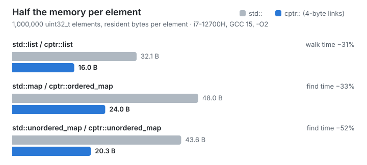

# Half your pointers are wasted



On a 64-bit machine every pointer is 8 bytes. In a linked structure the
pointers are often most of what you store. A `std::list<int>` node holds two
pointers and one 4-byte `int`: 24 bytes, and 32 once `malloc` has added its
header. Four of those bytes are your data. A `std::map<int, int>` node is
three pointers, a colour and the pair: 48 bytes resident for 8 bytes of
data.

Most of those pointer bits never change. A process rarely spreads one data
structure over more than 4 GiB of address space, so the top half of each
pointer repeats the same value in every node.

compressed-ptr stores only the half that changes.

## The trick

JavaScript engines and the JVM have done this for years: V8 calls it
[pointer compression](https://v8.dev/blog/pointer-compression), and the
JVM's compressed oops are on by default for heaps under 32 GiB. The idea
is the same in both:

1. Reserve one region of address space, 4 GiB long and aligned to 4 GiB.
   This costs address space, not memory: pages are committed as they are
   used.
2. Allocate the objects that point at each other inside that region (the
   *cage*).
3. Store a pointer into the cage as its 32-bit offset from the start.
   Turning it back into an address is one add.

```cpp
#include "cptr/all.hpp"

struct node {
  cptr::ptr<node> next;  // 4 bytes, not 8
  int value;
};

cptr::ptr<node> head = cptr::make<node>(nullptr, 1);  // allocated in the cage
node* raw = head;                                     // and back to a plain pointer
```

A `cptr::ptr<T>` converts to and from `T*`, so code that takes plain
pointers keeps working. With 8-byte alignment the offset can be shifted,
which stretches one cage to 32 GiB.

## What it buys

Swapping the container is the whole migration:

```cpp
cptr::list<int> l;                    // was std::list<int>
cptr::ordered_map<int, int> m;        // was std::map<int, int>
cptr::unordered_map<int, int> h;      // was std::unordered_map<int, int>
```

With a million 4-byte elements on an i7-12700H (GCC 15, `-O2`):

| | `std::` | `cptr::` | time |
|---|---:|---:|---:|
| list, walk | 32.1 B | **16.0 B** | **−31%** |
| map, find | 48.0 B | **24.0 B** | **−33%** |
| unordered_map, find | 43.6 B | **20.3 B** | **−52%** |

The memory halves because the links halve. The time drops because half the
memory means half the cache lines: once a structure is larger than your
caches, a walk is a chain of cache misses, and fewer bytes per node means
fewer misses. You can check this on your own machine with one program,
`examples/expect_gains.cpp`, or in the browser on
[Compiler Explorer](https://godbolt.org/z/cTz9KfczY).

## What it costs

Nothing here is free, and the [benchmarks page](benchmarks.md) says where it
loses:

- **Decompression is an add, plus a null check.** When a pointer chase fits
  in L1, that add is visible: up to 57% slower than raw pointers at the
  median. `cptr::nonnull_ptr` drops the null check and the gap to about
  17%. From L3 outwards the smaller nodes win.
- **Everything you compress must live in the cage.** Allocate with
  `cptr::make`, the bundled containers, or `cptr::allocator`. Compressing a
  pointer from elsewhere is a bug; debug builds assert, and
  `CPTR_CHECKED` keeps the check in release builds.
- **One structure, one cage, at most 4 GiB** (32 GiB with 8-byte
  alignment). Several cages are fine, as each has its own type.
- **Each Windows DLL gets its own cage.** On Linux and macOS shared
  libraries share one.

If your data already lives in arrays and vectors, this library has little to
offer you: there are no pointers to shrink.

## Why not something else?

**Indices into a `std::vector`.** Also 4 bytes, and often the right answer
for a single structure you write yourself. But an index only means
something next to its vector, you lose the `std` container interfaces, and
code that wants a `T*` needs the vector at hand. A compressed pointer is a
pointer: it dereferences, converts to `T*`, and one cage serves every type.

**`boost::interprocess::offset_ptr`.** Built for a different problem: data
in shared memory mapped at different addresses. It is 8 bytes by default.
compressed-ptr gets the same property as a side effect: a
`cptr::mapped_cage` keeps a whole structure in a file that can be mapped
anywhere.

**The x32 ABI.** 4-byte pointers for the whole process, which then cannot
use more than 4 GiB. Few distributions ship x32 libraries. compressed-ptr
shrinks only the structures you choose.

**A bigger machine.** Sometimes. Halving the memory of your largest
structures is often cheaper, and faster too.

## Try it

- [Compiler Explorer](https://godbolt.org/z/cTz9KfczY): edit and run in the
  browser, no install.
- [Start in two minutes](../README.md#start-in-two-minutes): a complete
  CMake project.
- [Guide](guide.md): how the cage works, every header, the rules.

compressed-ptr is MIT-licensed and header-only. It needs C++20 and a 64-bit
target, and CI covers Linux, macOS and Windows with GCC, Clang and MSVC.
Questions, ideas and benchmark results from your hardware are welcome in
[Discussions](https://github.com/mvanslobbe/compressed-ptr/discussions).
